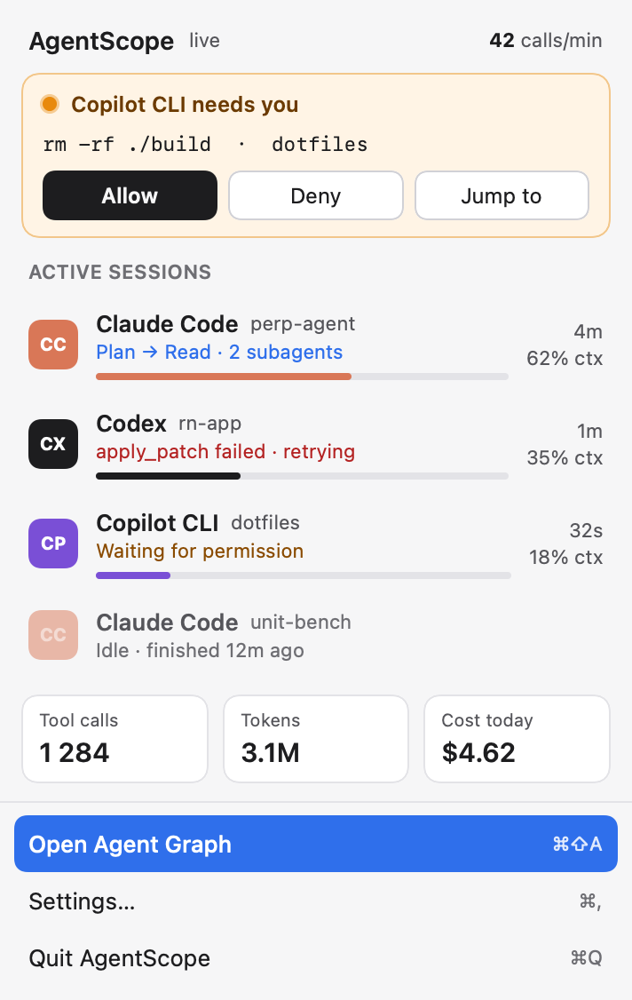
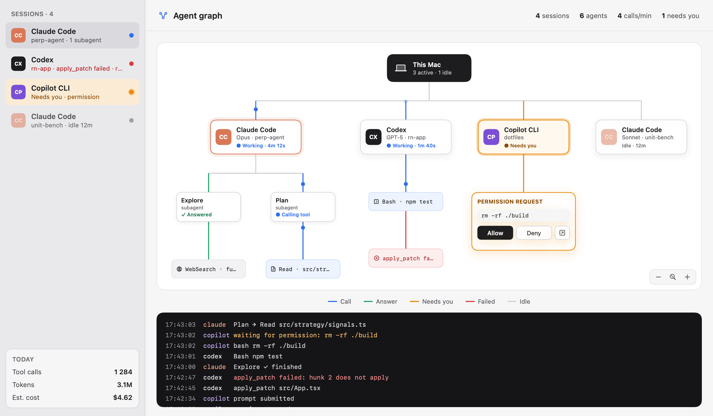

# AgentScope

A macOS menu bar app and CLI that shows every AI coding agent running on your Mac — **Claude Code**, **Codex CLI** and **GitHub Copilot CLI** — as a live graph: sessions → subagents → tool calls, with who is working, who needs you, what failed, context usage and estimated cost.

<p>
  
  &nbsp;
  
</p>

- **One glance:** the menu bar icon shows how many agents are working, with an orange dot when one waits for your permission, red when a tool call just failed, green when an agent finished and it's your turn.
- **Inbox order:** what needs you first, then agents waiting for your next prompt (longest first, "Your turn · waiting 7m"), failures, work in progress.
- **Needs you:** a notification and a banner the moment an agent asks for permission.
- **Go to the agent:** click a session in the popover (or ↗ on a sidebar row or graph node) to land in its window — the Terminal / iTerm2 tab, the tmux pane, or the IDE window of its project. Right-click for more: open the project in VS Code / Cursor / Zed, a new terminal there, Finder, the graph or its turns.
- **Allow / Deny** (Claude Code, opt-in in Settings): answer the permission prompt from the popover, the graph or the notification; after a short wait Claude asks in the terminal as usual.
- **Quick switcher:** ⌃⌥Space from any app, type to filter, ↩ jumps to that agent's window.
- **Looks stuck:** the same call failing in a row, a call running for 10+ minutes, or silence while working gets flagged (and notified).
- **repo · branch** for every session, worktrees included, so five sessions in one repo stay apart.
- **Timeline:** a recap of every turn — duration, files changed, commands run, failures, tokens and cost (never prompt text).
- **Usage:** 7 or 30 days by agent, project and model, plus the last five hours, read from the agents' transcripts (so it includes days before you installed AgentScope).
- **Guardrails:** optional limits for one session's cost, the day's cost and context fill; warnings on the session and as notifications.
- **Agent graph:** This Mac → sessions → subagents → tool calls, animated as calls go out and answers come back. Click any node for details; pan and zoom.
- **Spend:** today's tool calls, tokens and estimated cost, overall and per agent.
- **100 % local.** No network calls, no accounts. Prompt text is never stored.

## Install

```bash
brew tap shklyarovalera/agent-scope https://github.com/ShklyaroValera/agent-scope
brew install --cask shklyarovalera/agent-scope/agentscope
```

The repository is its own tap (`Casks/agentscope.rb`), so `brew upgrade` picks up new releases.

Or download `AgentScope-<version>.zip` from [Releases](https://github.com/ShklyaroValera/agent-scope/releases), move `AgentScope.app` to `/Applications` and link the CLI:

```bash
ln -s /Applications/AgentScope.app/Contents/Helpers/agentscope /usr/local/bin/agentscope
```

Builds without a Developer ID signature need `xattr -cr /Applications/AgentScope.app` once.

## Connect your agents

```bash
agentscope setup
```

`setup` finds the installed agents and adds AgentScope hooks to their configs. It merges with what is there, never touches your own hooks, backs up each file it changes (`*.agentscope-backup-<date>`) and is safe to run again. The popover offers the same on first launch, and **Settings → Agents** shows each agent's status.

| Agent | Config | Notes |
|---|---|---|
| Claude Code | `~/.claude/settings.json` → `hooks` | Tested with 2.1.283. |
| Codex CLI | `~/.codex/hooks.json` | Tested with 0.162. Codex runs new hooks only after you trust them: start `codex`, type `/hooks`, approve the AgentScope entries. `agentscope doctor` tells you whether that is done. |
| Copilot CLI | `~/.copilot/hooks/agentscope.json` | Tested with 1.0.100. A file of its own; nothing else is edited. |

Sessions that started before `setup`, or whose hooks are not trusted yet, still show up from their transcripts, with token usage but without tool calls.

To disconnect, `agentscope uninstall` removes only AgentScope's entries. A file is restored byte for byte when nothing else changed since setup.

## CLI

```
agentscope setup [--agent claude|codex|copilot] [--dry-run]   add hooks (shows a diff with --dry-run)
agentscope uninstall [--agent …] [--dry-run]                   remove AgentScope's hooks only
agentscope status [--json]                                     what the menu bar shows, as a table
agentscope doctor                                              app running? hooks installed and trusted? hook fast?
```

`agentscope hook` is what the agents call. It reads the event from stdin, passes it to the app over a Unix socket (or a spool file when the app is not running), prints nothing, always exits 0 and finishes in a few milliseconds — an agent never waits on AgentScope.

## How it works

```
Claude Code ─┐  hook (stdin JSON)              ┌────────────────────┐
Codex CLI   ─┼─▶ agentscope hook ─▶ Unix socket ─▶│  AgentScope.app     │
Copilot CLI ─┘      (spool when app is down)   │  event store → UI   │
                                                └────────────────────┘
transcripts (~/.claude/projects, ~/.codex/sessions) ─▶ tokens, context %, cost
```

All three agents send Claude-style hook payloads; each agent's quirks are covered by tests against real captured payloads (`Tests/Fixtures/`). Costs are estimates from transcript token counts and an editable price table (`~/Library/Application Support/AgentScope/prices.json`). Claude Code's own cost total replaces the estimate when it reports one. Copilot is subscription-based, so it shows tool calls only.

## Privacy

AgentScope makes no network connections. Hook payloads stay in memory; only daily counters are written to disk (`~/Library/Application Support/AgentScope/stats.json`). Prompt text is dropped on arrival. **Settings → Debugging → Keep raw hook payloads** is the one exception: it saves raw payloads for building test fixtures and is off by default.

## Development

Requires macOS 14+ and Swift 6 (Xcode 16 or later).

```bash
swift build && swift test           # library, app and CLI; unit tests
scripts/integration-test.sh         # fixtures → real hook binary → app → agentscope status
scripts/allow-deny-e2e.sh           # real Claude Code permission prompt answered through AgentScope (2 short haiku runs)
scripts/build-app.sh                # build/AgentScope.app (debug, ad-hoc signed)
AGENTSCOPE_MOCK=1 open build/AgentScope.app   # the design mock data instead of live sessions
scripts/release.sh                  # universal release zip; signs/notarizes with DEVELOPER_ID / NOTARY_PROFILE
```

`SPEC.md` is the product and technical spec; `design/` holds the HTML mockups the UI follows; `CLAUDE.md` has notes for working on the code with Claude Code.

## License

Not yet chosen.
